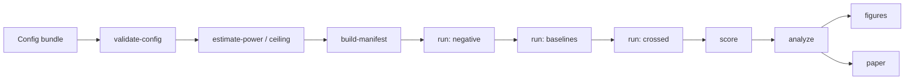

# MemSat

MemSat is an experimental harness for measuring how answer accuracy and retrieved
evidence change with retrieval depth `K` and per-session context budget `B` on
 conversational long-term memory benchmarks.

The repository contains the production harness under [`msat/`](msat/) and the
conference manuscript, figures, and replication package under [`paper/`](paper/).

## Layout

- `msat/` — Python CLI, configuration bundle, analysis code, tests, and committed result artifacts.
- `paper/` — LaTeX source, figures, compiled PDF, and a self-contained replication package.

## Requirements

- Python 3.12 and `uv`.
- Local benchmark data supplied with `--data` at run time.
- [Tectonic](https://tectonic-typesetting.github.io/) for PDF compilation (used by `msat paper`).

## CLI overview

Run commands from `msat/`, for example:

```sh
cd msat
uv run --no-sync msat --help
```

| Command | Purpose | Common options |
| --- | --- | --- |
| `validate-config` | Check required config fields and reader count | `--hash` |
| `estimate-power` | Simulate power for the interaction term | `--profile`, `--sims`, `--seed`, `--out` |
| `ceiling` | Compute `ceiling(K)`, `partial(K)`, `K*`, feasibility | `--by-type`, `--verify`, `--out` |
| `data-lock` | Write or verify SHA-256 locks for raw benchmark files | `--verify`, `--lock` |
| `build-manifest` | Build the Condition manifest and execution plan | `--profile`, `--out`, `--corpus`, `--limit` |
| `run` | Execute one ladder rung through the durable runner | `--profile`, `--rung`, `--plan`, `--results`, `--resume`, `--dry-run`, `--data` |
| `status` | Print the completion ledger and ladder state | `--ladder/--no-ladder`, `--results` |
| `score` | Re-score stored responses without model calls | `--profile`, `--metric`, `--gold`, `--results` |
| `judge-audit` | Audit repeated judge verdicts | `--verdicts`, `--human`, `--out` |
| `analyze` | Validate observations and fit the declared models offline | `--profile`, `--outcome`, `--bootstrap`, `--check` |
| `figures` | Regenerate figures from run artifacts | `--scores`, `--ceiling`, `--metric`, `--out` |
| `paper` | Build manuscript artifacts from stored analysis results | `--out` |
| `report-reader-capacity` | Report servable prompt depth per reader | `--config`, `--out` |
| `hardware-delta` | Plan or compare a cross-hardware probe | `--against`, `--probe/--compare`, `--n` |
| `vram` | Estimate a checkpoint's VRAM requirement | `--tokens`, `--quant`, `--card` |

Use `msat <command> --help` for the complete option list of any command.

## Typical workflow

```sh
# 1. Preflight
uv run --no-sync msat validate-config --hash
uv run --no-sync msat ceiling --verify --out work
uv run --no-sync msat estimate-power --profile full --out work

# 2. Plan and run the ladder
uv run --no-sync msat build-manifest --profile fast --out work/manifest_fast.json
uv run --no-sync msat run r_fast --profile fast --rung negative \
  --plan work/manifest_fast.json --results work/runs --data ../Research/context/raw
uv run --no-sync msat run r_fast --profile fast --rung baselines \
  --plan work/manifest_fast.json --results work/runs --data ../Research/context/raw
uv run --no-sync msat run r_fast --profile fast --rung crossed \
  --plan work/manifest_fast.json --results work/runs --data ../Research/context/raw

# 3. Score, analyse, and build figures
uv run --no-sync msat score r_fast --profile fast --metric em \
  --gold ../Research/context/raw/lme_oracle.json --results work/runs
uv run --no-sync msat analyze r_fast --profile fast --outcome em --results work/runs
uv run --no-sync msat figures --out ../paper/figures \
  --scores work/runs/r_fast/scores.parquet --ceiling results/ceiling.json --metric em

# 4. Build the manuscript
uv run --no-sync msat paper --out ../paper/build
```

## Pipeline



The ladder is ordered by what a failure costs: the negative control must collapse,
the baselines must render, and only then may the crossed grid run. A rejected cell
is reported, never silently truncated.

## Replication

The [`paper/reproduction/`](paper/reproduction/) package contains derived question and
pilot records plus a replay script. From the repository root:

```sh
uv run --no-project --python 3.12 --with-requirements paper/reproduction/requirements.txt \
  python paper/reproduction/replay.py
```
